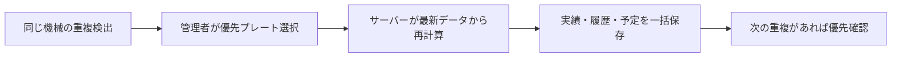

# 設備重複の優先確認（2026-10-22）

## 要件

同じ機械の時間重複で補助行を作らず、管理者が先に加工するプレートを選ぶ。後にするプレートを優先プレートの終了後へ移動する。完了実績・登録済み実績の履歴も修正することを利用者が承認済み。必須要件は優先確認、補助行廃止、時間幅維持、実績履歴との一致、後工程再計算。

## 設計・実装

- ガントは工程・機械ごとに1行。重複しても補助行を増やさない。別のワイヤー機械は別行のまま、同時加工可能。
- 既存の重複も、計画画面を開くと優先選択ダイアログで確認する。金型・プレート名、機械、日時、状態を表示する。
- 設備重複を伴う実績入力は、実績保存後に優先確認へ進む。同じ作業者の確認チェックを設備の優先確認より先に要求しない。設備重複がない作業者間重複の確認は従来どおり。
- 完了・作業中・固定の後順位タスクは、時刻を同じ移動量でずらす。複数の作業実績もすべて同量を移動し、実績の経過時間を維持する。
- 休憩控除後の計算値は保存済みの休憩スナップショットで再計算する。手動修正の作業時間・理由は維持する。
- 未着手の後順位タスクは、優先タスクの終了後を開始下限として、勤務時間・会社カレンダー・30分刻み・他の機械予定に従って配置する。空き時間がなければ次の稼働可能時間になる。
- 関連する未着手の後工程・同じ機械の後続予定を再計算する。その他の作業中・完了・固定予定は維持し、固定予定の先行条件を満たせない場合はエラーとして保存を取り消す。
- 重複確認中は1時間ごとの未着手遅延自動調整を止める。複数の既存重複がある場合は、一組ずつ選択して解消する。
- 優先選択は管理者のみ。担当者画面は管理者への確認依頼を表示する。

## API・DB

`POST /api/business` の `operation: resolveOverlap`、payloadは `winnerId`・`loserId`。サーバー側で認証・管理者権限・revision・対象の重複を確認し、共通の計算関数から保存内容を生成する。

`resolve_machine_overlap(jsonb,bigint)` RPCで、既存の実績保存RPCと予定保存RPCを同じトランザクションで呼ぶ。既存の競合検出と保護タスクの検証を維持する。どこかで失敗した場合は実績修正もrevisionもすべてロールバックする。

作業実績一覧と工程の登録済み実績は修正後の時刻を表示する。監査ログは過去の記録を上書きせず、変更前後と優先選択を追記する。変更前の証跡も保持する。

Supabase SQL Editorで `supabase/migrations/202610220001_resolve_machine_overlap.sql` を1回実行する。実行しただけでは既存データを移動せず、管理者の優先選択時に保存する。

## 検証・引き継ぎ

Critical：DB統合テストで実績とタスク時刻の一致、監査ログ、担当者拒否、途中エラー時の全件ロールバックを確認。
High：逆優先、複数実績、時間幅維持、未着手順序変更、後工程再計算、入力不変、異なる設備の拒否、補助行廃止を確認。
ローカルの実画面でDB1・DPの優先確認が表示され、自動研磨機が1行になったことを確認。実データの優先順位は選択していない。SQL適用と利用者による優先選択が残作業。

未確定事項なし。
